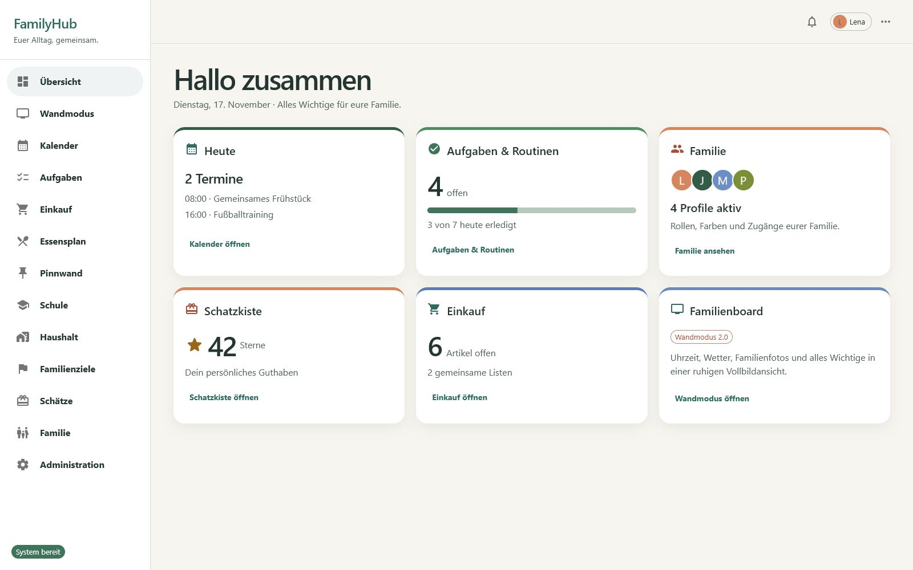
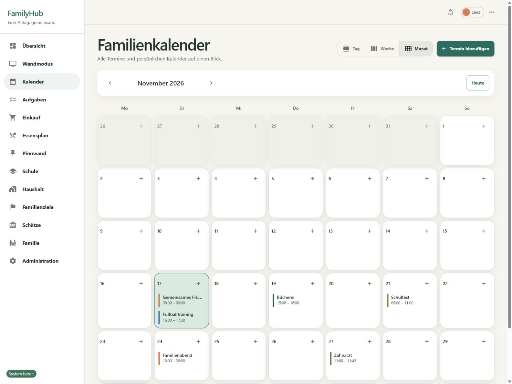
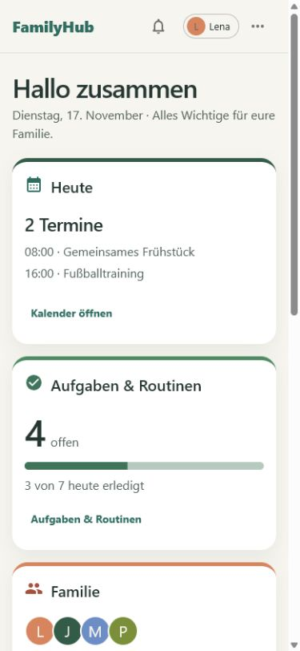
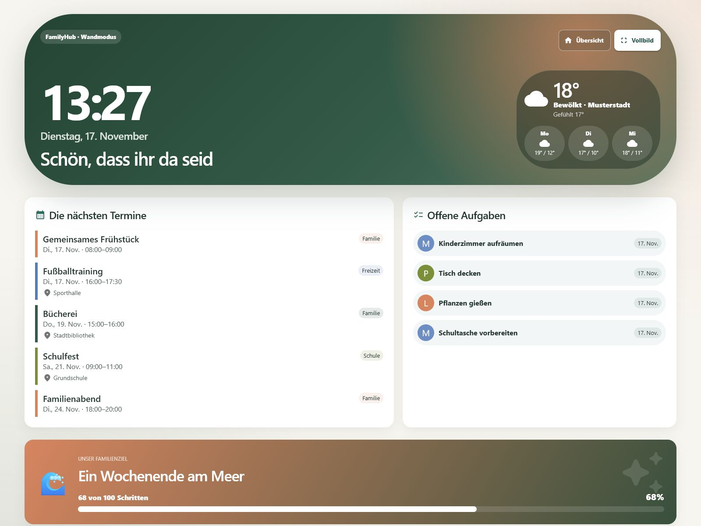

<p align="center">
  
</p>

<h1 align="center">FamilyHub</h1>

<p align="center">
  Der selbst gehostete Familienorganizer für Kalender, Aufgaben, Routinen und das gemeinsame Familienboard.
</p>

<p align="center">
  <a href="https://github.com/QuickLinkNet/familyhub/actions/workflows/quality.yml"></a>
  <a href="CHANGELOG.md"></a>
  
  
</p>

FamilyHub bündelt den Familienalltag in einer touch-optimierten React-PWA. Die native PHP-/SQLite-API läuft auf gewöhnlichem Webhosting, benötigt keine Framework-Laufzeit und hält Familien- und Zugangsdaten unter eigener Kontrolle.

> **Projektstatus:** FamilyHub ist als selbst installierbare Produktversion nutzbar und wird aktiv weiterentwickelt. Aktueller Stand: **v0.33.0**.

## Einblick

<p align="center">
  
</p>

<table>
  <tr>
    <td width="68%" valign="top">
      
    </td>
    <td width="32%" valign="top" align="center">
      
    </td>
  </tr>
  <tr>
    <td align="center"><sub>Familienkalender</sub></td>
    <td align="center"><sub>Responsive Mobilansicht</sub></td>
  </tr>
</table>

<p align="center">
  
  <br>
  <sub>Touch-optimierter Wandmodus für Tablet, Display oder Familienboard</sub>
</p>

> Sämtliche Namen, Termine, Orte und Werte in den Screenshots sind fiktive Beispieldaten.

## Warum FamilyHub?

- **Datenhoheit:** eigene Installation, eigene SQLite-Datenbank und portables Komplettarchiv
- **Für den Familienalltag gebaut:** Wanddisplay, Tablet und Smartphone mit großen Touch-Zielen
- **Kalender ohne Zwang:** Google Kalender read-only per iCal oder optional mit OAuth-Schreibzugriff
- **Ein gemeinsamer Ort:** Termine, Aufgaben, Routinen, flexible Listen, Einkauf, Essen, Schule und Haushalt
- **Schlanker Betrieb:** React/TypeScript im Frontend, natives PHP 8.2+ und SQLite im Backend

## Funktionsumfang

| Bereich | Enthalten |
| --- | --- |
| Kalender | Tag, Woche und Monat, Mehrpersonen-Termine, Profil-/Kalenderfilter, Wiederholungen, Geburtstage, private Termine und Google-Synchronisierung |
| Familienboard | konfigurierbarer Wandmodus mit Uhr, Wetter, Fotos, Terminen, Aufgaben, Schule und Nachtbetrieb |
| Aufgaben & Routinen | Zuständigkeiten, Serien, Morgen-/Abendroutinen, Fortschritt und Erinnerungen |
| Organisation | flexible und private Checklisten, Einkauf, Essensplan mit vollständiger Rezeptpflege, Pinnwand, Schule und Haushaltsplan |
| Motivation | Schatzkiste, Sternenguthaben, Wünsche und gemeinsame Familienziele |
| Betrieb | Einrichtungsassistent, Rollenrechte, Backups, Health-Check und portables `.familyhub`-Archiv |
| Benachrichtigungen | In-App-Hinweise und verschlüsselte Web-Push-Erinnerungen pro Gerät und Profil |
| Mobile Companion | Einmalige QR-Freigabe, geführte PWA-/Push-Einrichtung und widerrufbare Gerätesitzungen |

Die vollständige Übersicht steht in [docs/FEATURES.md](docs/FEATURES.md). Das langfristige Referenzziel dokumentiert die [Dæly-Paritätsroadmap](docs/DAELY_PARITY.md).

## Voraussetzungen

### Server

- PHP **8.2 oder neuer** mit `pdo_sqlite`
- Apache mit `mod_rewrite` oder eine gleichwertige Webserver-Konfiguration
- HTTPS für Anmeldung, PWA, OAuth und Web Push
- Schreibrechte für `storage/`

### Build und Entwicklung

- Node.js **20 oder neuer**
- npm mit `npm ci`

## Installation

```bash
git clone https://github.com/QuickLinkNet/familyhub.git
cd familyhub
npm ci
npm run build
```

Der Build erzeugt unter `deploy/` ein vollständiges Paket aus Frontend, API und geschützter Storage-Struktur. Lade dessen Inhalt in das Document Root der gewünschten Domain. Beim ersten Aufruf führt `/setup` durch Haushalt, Profile und Kalender.

Die vollständige Anleitung einschließlich Apache, Unterpfadbetrieb, Google OAuth, Backups und Web Push steht in [docs/INSTALLATION.md](docs/INSTALLATION.md).

## Entwicklung

Das Frontend arbeitet bewusst gegen eine explizit konfigurierte FamilyHub-API:

```bash
npm ci
cp .env.local.example .env.local
npm run dev
```

Unter Windows kann statt `cp` `Copy-Item` verwendet werden. Trage in `.env.local` die URL deiner Test- oder Entwicklungsinstallation ein. Vite startet anschließend unter `http://localhost:5173`.

### Relevante Befehle

```bash
npm run dev                 # Entwicklungsserver
npm run build               # Typecheck, Production-Build und deploy/-Paket
npm run test:deploy-config  # Validierung der Deployment-Konfiguration
npm run deploy              # Build und FTP/FTPS-Upload
```

## Architektur

```text
src/        React, TypeScript, Material UI und Feature-Module
api/        native PHP-API mit Controller-/Service-/Repository-Schichten
storage/    geschützte SQLite-Daten, Backups, Schlüssel und Laufzeitlogs
design/     öffentliche Design-Library und versionierte Screen-Spezifikationen
docs/       Installation, Architektur, API, Datenbank und Roadmap
scripts/    reproduzierbarer Build und providerneutrales Deployment
```

Frontend und Backend werden gemeinsam ausgeliefert, bleiben technisch aber klar getrennt. Details erläutert [docs/ARCHITECTURE.md](docs/ARCHITECTURE.md).

## Sicherheit und Datenschutz

FamilyHub verwendet serverseitige Rollenrechte, HttpOnly-Sessions, CSRF-Schutz, Passwort-/PIN-Hashes und verschlüsselt sensible Kalender-, OAuth- und Push-Zugangsdaten. Das Repository enthält weder Betreiber-Secrets noch installationsspezifische Werte.

Sicherheitslücken bitte **nicht** in öffentlichen Issues melden. Der verantwortliche Meldeweg und das Sicherheitsmodell stehen in [SECURITY.md](SECURITY.md).

## Dokumentation

| Dokument | Inhalt |
| --- | --- |
| [Installation](docs/INSTALLATION.md) | Hosting, Ersteinrichtung, OAuth, PWA und Backups |
| [Architektur](docs/ARCHITECTURE.md) | Frontend-, Backend- und Deployment-Struktur |
| [API](docs/API.md) | Endpunkte, Rollen und Antwortformate |
| [Datenbank](docs/DATABASE.md) | SQLite, Migrationen, Sicherungen und Archive |
| [Features](docs/FEATURES.md) | aktueller Funktionsumfang und Produktlücken |
| [Changelog](CHANGELOG.md) | versionierte Änderungen |

## Mitwirken

Beiträge sind willkommen. Bitte vor dem ersten Pull Request [CONTRIBUTING.md](CONTRIBUTING.md) sowie die öffentlichen Design- und Datenschutzregeln lesen.

## Lizenz

Für FamilyHub ist noch keine Open-Source-Lizenz festgelegt. Der Quellcode ist öffentlich einsehbar; Kopieren, Weitergabe und kommerzielle Nutzung benötigen bis zu einer bewussten Lizenzentscheidung die Zustimmung des Rechteinhabers.
